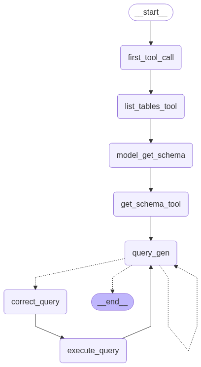
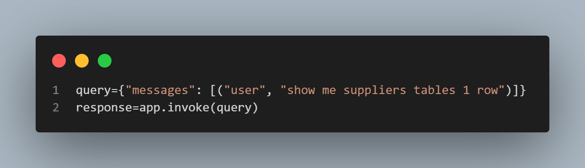
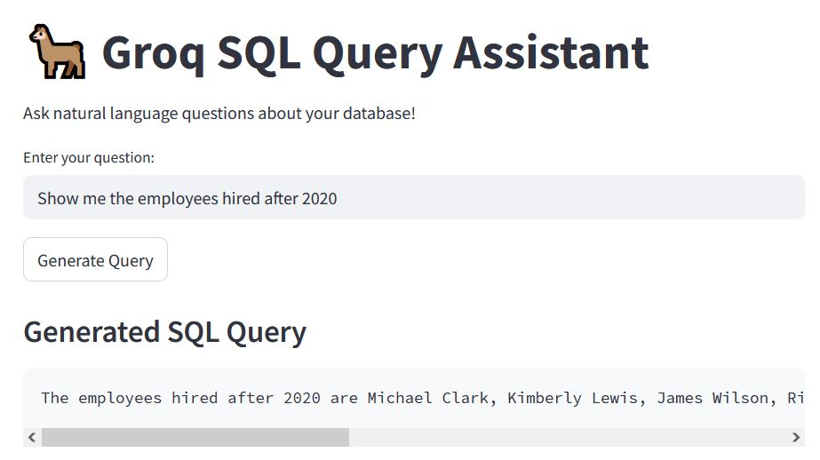

# SQL Conversational Agent with PostgreSQL

[](https://opensource.org/licenses/MIT)

Ask questions about a PostgreSQL database in plain English. A LangGraph pipeline picks the relevant tables, writes the SQL with an LLM on Groq, reviews it, runs it with a read-only user, fixes and retries it if the database returns an error, and explains the result.

**Accuracy:** 14/15 on single questions (the one miss returned the correct month in a different format) and 7/7 on follow-up conversations (`evaluation/`).

## Features

- Saved chats like Claude/ChatGPT: a sidebar of past conversations you can reopen and continue (stored in PostgreSQL)
- Follow-up questions: "now only for Germany" or "what about the 3 cheapest?" are rewritten into standalone questions using the conversation so far
- Natural language to SQL with few-shot examples (joins, window functions, nested subqueries)
- Schema linking: a keyword + foreign-key graph selector sends only the relevant tables to the model
- SQL review step, then automatic error correction (up to 3 retries using the real database error)
- Safe by design: read-only database user, 10 s query timeout, single-SELECT guard; chats use a separate user that can't see the sales data
- Automatic charts: time results become a line chart, categories a bar chart (picked from the result shape, no extra LLM call; hover tooltips, light/dark)
- Next.js chat UI with live pipeline progress, highlighted SQL, earlier failed attempts and a result table
- FastAPI backend that streams each pipeline step to the browser (server-sent events)

## How it works

```
START -> rewrite_question -> generate_sql -> check_sql -> execute_sql --ok--> answer -> END
                                                              ^    |
                                                              |  error (retries left)
                                                           fix_sql <-+
```

`rewrite_question` only calls the model when there is earlier conversation (the last 3 turns are used).

## Setup

Requirements: Python 3.12, Node.js 20+, PostgreSQL 16, a free [Groq API key](https://console.groq.com/keys).

```bash
# 1. Python environment
uv venv .venv && uv pip install -r requirements.txt   # or: python -m venv .venv && .venv/bin/pip install -r requirements.txt

# 2. Config: copy the template and paste your Groq key
cp .env.example .env

# 3. Database: creates nlp_to_sql + owner, read-only and chat users, writes the URLs into .env
bash database/create_db.sh

# 4. Sample data (6 tables, 5,000 orders over 18 months) + saved-chat tables
.venv/bin/python database/seed.py

# 5. Website dependencies
cd web && npm install && cd ..
```

## Usage

```bash
./start.sh                                                  # API on :8100 + website on http://localhost:3100
.venv/bin/python -m zax_backend.main "Which 5 products have the lowest stock?"   # one question in the terminal
.venv/bin/pytest -q                                         # tests (no API key needed)
.venv/bin/python -m evaluation.evaluate                     # accuracy test (uses Groq)
.venv/bin/python -m evaluation.evaluate followups           # follow-up conversation test
```

Change the model with `GROQ_MODEL` in `.env` (default `openai/gpt-oss-120b`). On Groq's free tier expect about 1–3 questions per minute because of the token-per-minute limit.

## Project Structure

```
.
├── start.sh                  # starts API + website together
├── web/                      # Next.js frontend (app/page.tsx, components/, lib/api.ts)
├── api/server.py             # FastAPI: /api/ask (streaming), /api/chats, /api/schema, /api/health
├── api/chats.py              # saved conversations (app schema)
├── zax_backend/
│   ├── workflow.py           # LangGraph pipeline
│   ├── prompts.py            # generation, review, correction and answer prompts
│   ├── table_selector.py     # picks relevant tables (keywords + join-path search)
│   ├── db_schema_utils.py    # reads table/column/foreign-key info from PostgreSQL
│   ├── tools.py              # SQL cleanup, read-only guard, query runner
│   ├── config.py             # .env loading, database engine, LLM
│   └── main.py               # command-line entry point
├── database/
│   ├── schema.sql            # info schema (6 tables)
│   ├── app_schema.sql        # app schema: saved chats and messages
│   ├── create_db.sh          # database + users
│   └── seed.py               # realistic sample data
├── evaluation/               # 15 questions with correct SQL + scoring script
├── tests/                    # offline tests incl. API (fake LLM, real database)
└── archive/                  # first versions: notebook and single-file backend
```

### Database

`customers`, `orders`, `order_details`, `products`, `suppliers`, `sales_representative` in the `info` schema. Order totals always equal the sum of their line items, and a few products grow in popularity over time so trend questions have answers.

### First version graph (notebook)



## Example Queries


## Interface (first version, Streamlit)




## Acknowledgments

- LangChain / LangGraph for agent orchestration
- Groq for ultra-fast LLM inference
- PostgreSQL for reliable database management


## YOU CAN FACE ULTRARAGE

